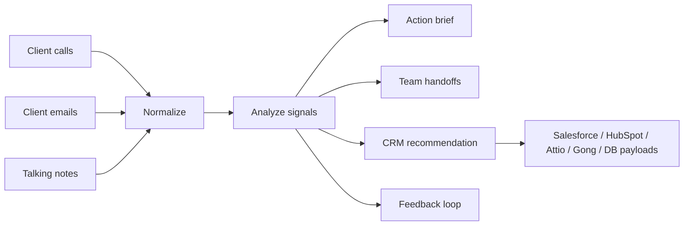

# Client Communications To CRM Public Showcase

This repo is a public reference version of a private AI workflow. It preserves the real workflow shape, data mapping, handoff logic, CRM recommendation pattern, and implementation lessons while using synthetic examples instead of private client data, credentials, schemas, transcripts, or customer details.

## Executable Scope

The public code uses deterministic rules and local JSON. It makes no model calls, consumes no live calls or email, and executes no CRM requests.

- Whole-word, clause-scoped rules recognize explicit requests and concerns. Negated requests and common resolution phrases are suppressed.
- Recommendations retain source evidence and require review. No actionable signal means no stage-change recommendation.
- Derived analysis is bound to its source records; a different account's analysis cannot be reused. Non-stage signals retain useful notes while omitting stage fields entirely.
- Mapping previews require one explicit account identity. Missing identity holds the plan; mixed accounts are rejected.
- Recommendation IDs hash account identity and sorted source-event identities. Reordering input preserves IDs; different accounts or source IDs produce different IDs.
- Supply immutable `communication_id` values. Content fallback cannot distinguish identical source events.
- Adapters illustrate mappings. Vendor field names, status labels, and target-record resolution still require validation.

Use Python 3.10+ and install pytest with `python3 -m pip install pytest`. Preview one adapter with `python3 -m src.client_ops.cli --mode integrations --destination salesforce`. Defaults are generic CRM and warehouse, plus a call-note mapping when applicable. No destination is contacted.

The rules do not reliably infer sarcasm, complex negation, temporal changes across messages, or buying intent. Human review and broader evaluation remain necessary.

## What This Demonstrates

- Turning client calls, emails, and meeting notes into action-ready operating notes.
- Extracting client asks, blockers, buying signals, and feedback loops.
- Routing next steps to sales, marketing, engineering, and customer success.
- Recommending CRM status changes with evidence and a write boundary.
- Building destination-specific integration payloads for Salesforce, HubSpot, Attio, Gong, generic CRM, and warehouse/database sinks.
- Keeping human review visible before any CRM mutation.

## Workflow

1. **Intake:** collect call summaries, client emails, and internal talking notes.
2. **Normalization:** reduce each source into a shared operating record.
3. **Signal extraction:** identify pricing/proposal asks, technical blockers, proof needs, onboarding feedback, and launch/messaging needs.
4. **Actioning:** create next steps with owner-team routing.
5. **CRM recommendation:** suggest status changes and field updates without writing directly by default.
6. **Integration mapping:** identify destination systems, object names, field names, external IDs, and write operations.
7. **Feedback loop:** capture repeated client friction as future qualification, onboarding, or handoff improvements.

## Why This Matters

Client communication usually creates operational drift: one person hears a blocker, another owns the next step, a CRM stage gets stale, and feedback never becomes process improvement. This sample shows how AI can sit between messy communication and the operating system of the business.

The goal is not to replace judgment. The goal is to make the judgment inspectable:

- What did the client actually say?
- What should happen next?
- Who owns it?
- What CRM status or field should change?
- What did we learn for the next client?

## Architecture



## Run It

```bash
python3 -m pytest
python3 -m src.client_ops.cli --mode brief
python3 -m src.client_ops.cli --mode crm
python3 -m src.client_ops.cli --mode integrations
```

## Repo Structure

- `src/client_ops/`: representative implementation.
- `tests/`: behavior tests for normalization, signal extraction, handoffs, and rendering.
- `examples/`: fake client inputs and generated outputs.
- `docs/`: architecture, sanitization notes, and reviewer guide.
- `docs/integration-contract.md`: destination identification, object mapping, field naming, and review gates.

## How A CTO Or Engineer Should Review This

The main question is whether the mapping makes sense:

- Can a terminal run take fake communication records and produce deterministic action notes?
- Are inputs normalized before analysis?
- Are CRM changes recommendations with evidence, not blind writes?
- Are Salesforce, HubSpot, Attio, Gong, and database payloads mapped with clear object names and field conventions?
- Are destination names normalized before routing?
- Is there a stable external ID convention to prevent duplicate writes?
- Are team handoffs explicit enough for sales, marketing, engineering, and customer success?
- Is the feedback loop real, or just a summary?

This sample is intentionally small. It is meant to show how the system is built and how AI-assisted operations work, without exposing private company data or overcomplicating the public fork.

## What Was Removed For The Public Version

- No real client names.
- No real companies.
- No real call transcripts.
- No real emails.
- No real CRM field IDs.
- No API keys, tokens, webhook URLs, or workspace IDs.

See `docs/sanitization-notes.md` for the full release boundary.
